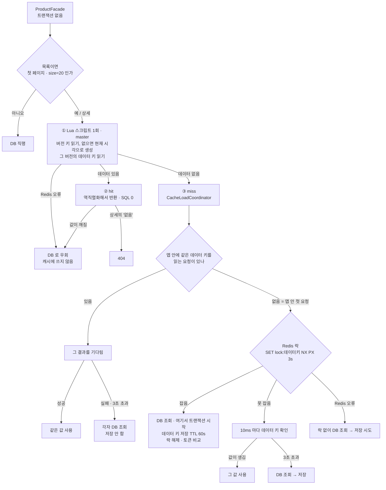
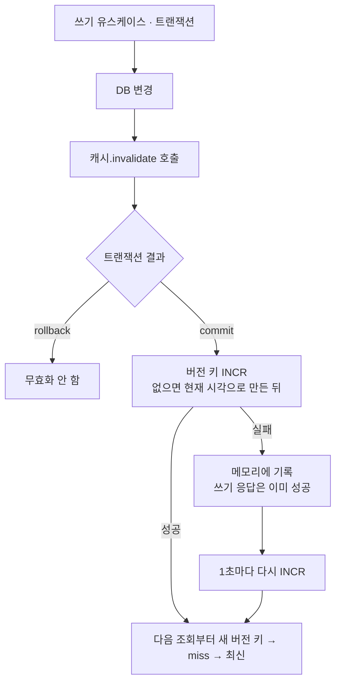
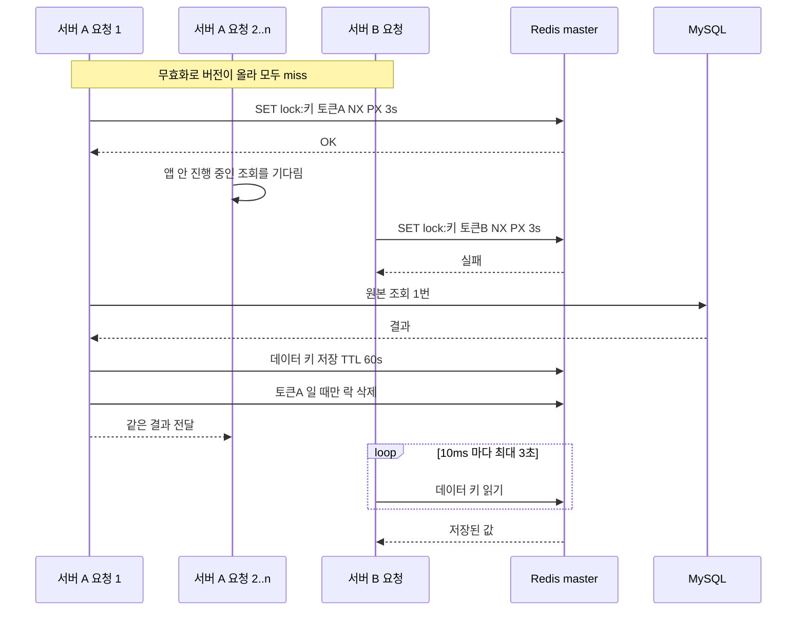
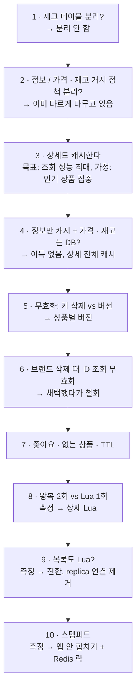

# 캐시 흐름과 결정 기록 (회고용)

4주차 후반(2026-10-18)에 상품 상세 캐시 · Lua 읽기 · 스템피드 대책을 AI 와 함께 설계하며 결정이 어떻게 바뀌었는지 남긴다. 1부는 지금 코드의 흐름, 2부는 결정이 바뀐 순서와 근거다. 근거 수치는 각 측정 문서에 있다.

---

# 1부. 지금의 흐름

## 1.1 조회 (목록 첫 페이지 · 상세 공통)

- **버전을 먼저 읽고 DB 를 나중에 읽는다.** 늦은 채움(변경 전에 읽은 값을 나중에 저장)은 옛 버전 키에만 들어가 새 조회에 보이지 않는다.
- **캐시 확인은 트랜잭션 밖이다.** 트랜잭션이 먼저 열리면 버전을 읽기 전의 스냅샷으로 새 버전 키를 채울 수 있다(REPEATABLE READ).
- **락 키에 버전이 들어간다.** 무효화 뒤의 요청은 옛 버전을 읽는 요청을 기다리지 않는다.
- **캐시 쪽 문제로 조회가 실패하지 않는다.** Redis 오류 · 첫 요청 실패 · 대기 초과는 모두 DB 조회로 끝난다.

## 1.2 쓰기와 무효화

| 쓰기 | 목록 (브랜드 + 전체 버전) | 상세 (상품 버전) |
|---|---|---|
| 상품 생성 | O | O (새 ID. "없음" 캐시 때문) |
| 상품 수정 · 삭제 | O | O |
| 재고 변경 · 주문 확정 | 품절이 뒤집힐 때만 | 품절이 뒤집힐 때만 |
| 브랜드 수정 · 일괄 삭제 | O | X (TTL 60초 허용) |
| 좋아요 등록 · 취소 | X (TTL 허용) | X (TTL 허용, 누른 직후는 좋아요 응답의 likeCount 로 갱신) |

## 1.3 스템피드: 서버 두 대에 동시 miss

## 1.4 목록과 상세의 차이

| | 목록 | 상세 |
|---|---|---|
| 캐시 대상 | 첫 페이지 · size=20 만 | 모든 상품 ID |
| 버전 단위 | 범위 (`brand={id}`, `all`) | 상품 |
| 데이터 키 | `product-list:v1:{범위}:ver={v}:sort={정렬}` | `product-detail:v1:{id}:ver={v}` |
| 없는 대상 | 빈 페이지가 결과 | "없음" 저장 → 404 |
| 값 크기 | 약 3KB | 약 150 bytes |

---

# 2부. 결정이 바뀐 순서

표의 "주체"는 결정을 누가 했는지다. **나** = 내가 정함, **AI 제안 채택** = AI 가 비교 · 권장하고 내가 받아들임, **AI 정정** = AI 가 틀리게 말했다가 바로잡음.

### 1. 재고를 별도 테이블로 뺄까 → 빼지 않음

| 항목 | 내용 |
|---|---|
| 처음 생각 | 재고는 자주 바뀌니 별도 테이블로 빼면 락이 덜 걸리지 않을까 (실무에서 대부분 분리한다고 들음) |
| 바뀐 이해 | 분리는 **다른 경로**(상품 수정 등)와의 잠금 경합을 줄일 뿐, **같은 재고끼리의 경합**(인기 상품 주문)은 그대로다. 일반 SELECT 는 MVCC 라 행 잠금을 기다리지 않는다. 실무에서 분리하는 큰 이유는 동시성보다 옵션(SKU) · 창고별 재고 같은 모델 차이다 |
| 결정 | 지금은 분리하지 않는다(3주차 설계 4.1 유지). 옵션 · 창고별 재고, 상품 행을 자주 쓰는 경로가 생기면 다시 본다 |
| 주체 | AI 제안 채택 |
| AI 정정 | 처음 "비정규화가 안 되어 있다"는 말에, 재고를 빼는 건 비정규화가 아니라 테이블을 나누는 것(정규화 쪽)이라고 용어를 바로잡음 |

### 2. 정보와 가격 · 재고의 캐시 정책을 나눌까 → 이미 나뉘어 있음

- 목록 캐시는 재고 **수량**이 아니라 **품절 여부**만 담아, 차감마다 무효화하지 않는다. 가격은 수정 commit 직후 버전을 올린다. 즉 변경 빈도가 다른 데이터를 이미 다르게 다루고 있었다.
- 목록에서 가격은 `price_asc` 의 **정렬 키**라, 가격만 캐시 밖으로 빼도 순서는 다시 무효화해야 한다.
- 주체: AI 가 기존 설계를 짚음. 가격 TTL 이 60초냐는 질문에 "60초는 장애 때의 상한, 정상은 즉시 반영"으로 정리.

### 3. 상세도 캐시한다

| 항목 | 내용 |
|---|---|
| 기존 결정 | 상세는 원본 p50 약 2.8ms 라 캐시하지 않음(`cache-design.md` 1절) |
| 바꾼 이유 | 목표를 "조회 성능 최대"로 두고, 인기 상품에 트래픽이 몰린다고 가정. 2.8ms 중 1.5~2ms 는 SQL 이 아니라 커넥션 · 트랜잭션 · 왕복 비용이라 hit 가 통째로 없앤다 |
| 주체 | 나 |

### 4. 정보만 캐시하고 가격 · 재고는 DB 에서? → 상세 전체 캐시

- "가격 · 재고를 항상 DB 에서 읽는 게 비효율적"이라는 직감은 맞았지만 이유가 달랐다. DB 를 **한 번이라도** 다녀오면 원본 비용(대부분 왕복)을 그대로 내서 캐시 이득이 사라진다.
- 고객 응답은 재고 수량이 아니라 품절 여부만 내보내므로, 상세 전체를 캐시하고 품절이 뒤집힐 때만 무효화하면 된다.
- 주체: AI 제안 채택

### 5. 무효화: 키 삭제 vs 지연 재삭제 vs 상품별 버전 → 상품별 버전

- 기준을 내가 정함: **"재고 · 가격 말고는 60초까지 어긋나도 된다."**
- 늦은 채움이 생기면 키 하나에 든 값이 모두 옛 값이 되므로 가격만 따로 지킬 수 없다 → 키 삭제(A)는 탈락, 지연 재삭제(B)는 줄일 뿐 못 없앰 → 버전(C).
- 주체: 기준은 나, 결론은 그 기준에서 따라 나옴

### 6. 브랜드 삭제 때 상품 ID 를 조회해 상세를 무효화 → 채택했다가 철회

| 단계 | 내용 |
|---|---|
| 처음 | 브랜드 삭제는 bulk UPDATE 라 상품 ID 목록이 없다. "조회 쿼리를 날리면 안 되나?"라는 질문에 AI 가 가능하다고 답함(브랜드 `FOR UPDATE` 덕에 조회한 ID 와 지운 상품이 일치) → 채택. 큰 브랜드의 무효화 대상이 많은 건 감수 |
| 철회 | 이어서 "삭제된 상품이 잠시 보여도 주문에서 막히니 괜찮다", "브랜드명도 TTL 동안 괜찮다"로 정하자, 브랜드 쪽 무효화가 **통째로 필요 없어짐** |
| 배운 점 | 신선도 요구를 필드별로 나누자(가격 · 품절만 최신) 구현 범위가 크게 줄었다. 범위를 먼저 정하고 구현 방법을 고르는 순서가 맞았다 |
| 주체 | 나 |

### 7. 좋아요 · 없는 상품 · TTL

| 결정 | 내용 | 주체 |
|---|---|---|
| 좋아요는 무효화하지 않음 | 누른 직후는 좋아요 응답의 `likeCount`(이미 있는 계약)로 화면을 갱신. 새로고침하면 TTL 동안 1 정도 어긋날 수 있음을 받아들임. 무효화하면 인기 상품 키가 계속 사라져 스템피드 조건이 됨 | 나 (프론트 낙관적 업데이트 아이디어) |
| "없음"도 캐시 | 처음 "404 를 매번 DB 에서 읽는다"로 오해 → 캐시하므로 TTL 마다 1번임을 확인 → 캐시하지 않으면 어떻게 되는지 비교 → 유지. 대가: 상품 생성 때 새 ID 무효화 | 나 |
| "없음" 전달 방식 | `Optional` 로 받고 404 는 Facade 가 던짐. 2주차 4.4 의 "대상 없음 오류는 서비스가 던진다"에서 상세만 벗어나므로, 4.4 의 다시 검토할 조건을 넓혀 적음 | AI 제안 채택 |
| TTL 60초 | 목록과 같음 | 나 |
| 스템피드는 측정 먼저 | 대책 없이 시작 | 나 |

### 8. 왕복 2회(C) vs Lua 1회 → 측정 뒤 Lua

| 단계 | 내용 |
|---|---|
| 질문 | C 는 hit 마다 왕복이 하나 는다. 큰 손실인가? |
| 측정 1 | Redis 왕복만 따로: 1회 p50 약 0.23ms, C 는 정확히 두 배(`redis-round-trip.md`) |
| AI 정정 | AI 가 처음 "Lua 는 인기 상품 읽기가 모두 master 로 간다"를 C 의 장점처럼 말했으나, **C 도 버전을 hit 마다 master 에서 읽는다.** master 요청 수는 같고, replica 가 덜어 주는 건 데이터 송출뿐이라고 바로잡음. 또 "분산 환경에서 쓰기 어려운 쪽"은 C 가 아니라 Lua(Cluster 슬롯 제약)임을 정리 |
| 측정 2 | C 를 구현하고 실험 코드에서만 Lua 로 바꿔 MockMvc 로 비교: DB 만 약 3ms, C hit 약 1ms, Lua hit 약 0.6ms. Lua 가 C 보다 35~40% 짧음(`product-detail-cache.md`) |
| 관찰 | 요청 단위 차이(약 0.4ms)가 왕복만 잰 값(0.23ms)보다 컸다. 원인은 미확인 — 부분을 잰 값과 요청 단위로 잰 값이 다를 수 있다 |
| 결정 | Lua 로 전환. 목표(조회 성능 최대)에 맞고, 바뀌는 곳이 읽기 메서드 하나 |
| 주체 | 나 (AI 는 처음엔 C 를 권했다가, 목표를 다시 짚으며 Lua 로 기울어도 된다고 함) |

### 9. 목록도 Lua 로? → 측정 뒤 전환

- 상세(150 bytes)와 달리 목록은 약 3KB 라, 데이터까지 master 가 보내는 부담이 다르다는 점을 먼저 짚고 **측정으로 판단**하기로 함.
- 측정: hit p50 약 33~35% 감소(`product-list-cache-lua.md`). master 송출은 이 환경(master = replica)에서 잴 수 없어 초당 hit 수로 어림(1만 건에 약 30MB/s).
- 결정: 전환. 쓰는 곳이 없어진 replica 우선 연결은 제거. 측정 코드를 먼저 커밋한 뒤 실험용 변형을 지워 기록을 남김.
- 주체: 나 (진행 순서는 AI 제안 채택)

### 10. 스템피드 → 앱 안 합치기 + Redis 락

| 단계 | 내용 |
|---|---|
| 측정 (대책 전) | 무효화 직후 동시 N 개가 거의 모두 원본으로 감(N=100 에서 69~100번). 커넥션 풀 10 앞에서 줄 서며 N=100 p50 이 N=1 의 6~15배(`cache-stampede.md`) |
| 걸러진 후보 | 확률적 조기 갱신은 TTL 만료만 다루는데 이 프로젝트는 대부분 **무효화**로 키가 사라짐 → 탈락. 옛 값을 내주며 갱신(stale-while-revalidate)은 가격 · 품절 최신 요건과 충돌 → 탈락. **요건이 대책을 걸렀다** |
| 내 기준 | "DB 조회 자체를 최대한 줄이고 싶다", "서버는 여러 대로 가정", "실패하거나 한도를 넘으면 각자 원본을 읽는다" |
| 결정 | 앱 안 요청 합치기 + Redis 락(`stampede-design.md`). AI 는 서버 1대 가정이면 앱 안 합치기만으로 충분하다고 권했으나, 여러 대 가정에 따라 둘 다 둠 |
| 측정 (대책 뒤) | 모든 시행에서 원본 1번, N=100 p50 약 9~11ms. 대가로 혼자 오는 miss 는 약 6 → 7~8ms |
| 주체 | 나 |

---

# 3부. 돌아볼 때 쓸 메모

## AI 와 설계할 때 효과가 있었던 것

- **결론보다 기준을 먼저 정했다.** "가격 · 품절만 최신", "DB 조회 최소화", "서버 여러 대", "캐시 문제로 조회가 실패하지 않는다". 기준이 정해지자 대안 비교가 짧아졌고, 기준이 바뀌자(6번) 앞선 결정을 되돌릴 수 있었다.
- **감이 아니라 측정으로 정했다.** 왕복 하나(8번), 목록 값 크기(9번), 스템피드(10번) 모두 "재 보고 정하자"를 먼저 했다. 측정 코드는 결정 전에 커밋해 지운 뒤에도 다시 돌릴 수 있게 했다.
- **AI 의 설명을 그대로 믿지 않고 되물었다.** "master 에 요청 수가 똑같이 몰리면 Lua 가 낫지 않나?", "왕복 2회면 분산 환경에서 쓰기 어렵다는 거야?" 같은 되물음에서 AI 의 틀린 설명(8번)이 드러났다.

## 남은 질문

- 목록 원본이 스템피드 실험에서는 약 6ms, 목록 측정에서는 약 24ms 였던 차이(`cache-stampede.md` 관찰 6)
- Lua 의 이득이 왕복만 잰 값보다 컸던 이유(`product-detail-cache.md` 관찰 3)
- 혼자 오는 miss 가 락 왕복 2번(약 0.5ms)보다 더 느려진 이유(`stampede-design.md` 7)
- master 송출 부담(목록 약 3KB × hit 수)은 실제로 재지 않았다

## 커밋 순서

| 커밋 | 내용 | 결정 |
|---|---|---|
| `081d30c` | Redis 왕복만 따로 측정 | 8 |
| `4fcdb55` | 상세 캐시 (상품별 버전, "없음" 캐시, Lua 읽기) | 3~8 |
| `a53c137` | 상세 hit 비교 (DB 만 · C · Lua) | 8 |
| `a4f09a3` | 목록 Lua 측정 | 9 |
| `9883712` | 목록도 Lua 로 전환, replica 연결 제거 | 9 |
| `8bce0c8` | 스템피드 대책 (CacheLoadCoordinator) | 10 |
| `2d00ff5` | 스템피드 대책 전후 측정 | 10 |
